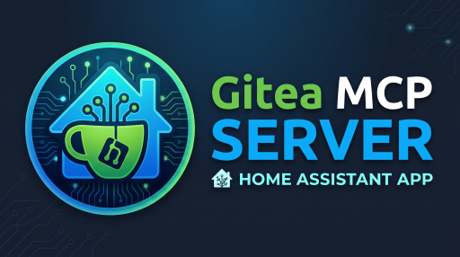

<!-- header:begin (generated from project metadata) -->
<h1 align="center">
  
</h1>

<p align="center">
  <a href="https://paypal.me/seb5594"></a>
  <a href="https://buymeacoffee.com/seb5594"></a><br>
  <a href="https://my.home-assistant.io/redirect/supervisor_add_addon_repository/?repository_url=https%3A%2F%2Fgithub.com%2Fseb5594%2FHome-Assistant-Apps"></a>
  <a href="https://github.com/seb5594/Home-Assistant-Gitea-MCP-Server-App/releases/tag/v1.13.0"></a>
  <br>
  
  
  <br>
  <a href="https://github.com/seb5594/Home-Assistant-Apps/issues"></a>
  
  <a href="https://github.com/seb5594/Home-Assistant-Gitea-MCP-Server-App/actions/workflows/ci.yml"></a>
  <a href="https://github.com/seb5594/Home-Assistant-Apps#license"></a>
</p>
<!-- header:end -->

Brings the official [Gitea MCP server](https://gitea.com/gitea/gitea-mcp) to Home Assistant.
Connect MCP clients to repositories, files, issues and pull requests in your Gitea instance.

* **Minimal permissions.** No Supervisor or Home Assistant API, no folders, no Docker, no host
  network. The address of the [Gitea app by alexbelgium](https://github.com/alexbelgium/hassio-addons/tree/master/gitea)
  is already filled in; you add an access token.
* **Safe by default.** Read-only, ports closed, tool groups to choose from.
* **Local and remote.** Local clients use the configured access token. Optional remote access uses
  OAuth with each user's Gitea account.
* **English and German.** The app page follows your browser, the configuration follows your Home
  Assistant language.

## Install

📲 In Home Assistant open **Settings → Apps → App store → ⋮ → Repositories**, add
`https://github.com/seb5594/Home-Assistant-Gitea-MCP-Server-App` and install **Gitea MCP-Server**.
Older versions call these *Add-ons* and *Add-on store*. Setup, remote access and troubleshooting
are in the [documentation](gitea_mcp_server/DOCS.md).

## How it fits together

```text
Home Assistant ──► :8080  local server  ──┐  access token
                                                   ├──► Gitea
MCP clients ──► tunnel ──► :8081 remote server ────┘  OAuth, per user
```

Both servers are the same official binary, started with different settings. The app only wires it
into Home Assistant: it checks the connection and writes the setup guide.

## Development

```text
gitea_mcp_server/
  config.yaml, translations/    options and their labels
  rootfs/usr/lib/gitea-mcp/     shell libraries: options, checks, status
  rootfs/etc/s6-overlay/        the MCP service and the app page service
  rootfs/usr/share/gitea-mcp/   the app page (plain HTML, CSS and JavaScript)
.github/tests/runtime.sh        runs inside the built image
.github/workflows/upstream.yml  follows the releases of Gitea MCP
```

The runtime test starts a real `gitea-mcp` against a mocked Gitea and asks it for its tools over MCP.
The app version matches the packaged Gitea MCP version. A scheduled workflow follows stable
upstream releases and updates the Docker image pin, app version and changelog together.
Base image and package updates can be tested independently and ship with the next upstream release.

<!-- support:begin (generated, shared text) -->
## Say thanks

All my projects are built in my spare time, just for the fun of it. Still, they take a lot of time and care, and many of the smart home gadgets I buy end up here because I want to make them cloud-free and smart-home ready. Every bit of support means a lot to me.

If my work helped you or turned out to be useful, show your appreciation with a hot drink for my next sleepless night.

[](https://paypal.me/seb5594) [](https://buymeacoffee.com/seb5594)
<!-- support:end -->

<!-- license:begin (generated from the license file) -->
## License

[](LICENSE)

Published under the [MIT License](LICENSE).
<!-- license:end -->
